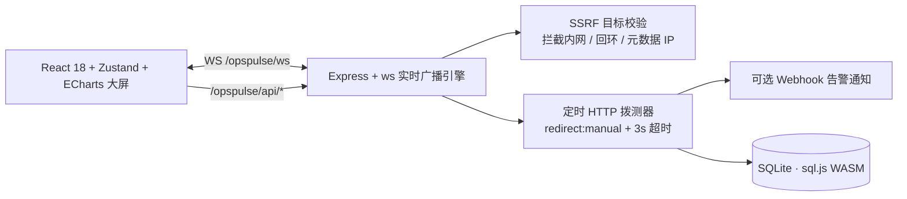

# 脉搏智维 OpsPulse — 实时服务健康拨测与 DataV 可视化运维大屏

[](https://github.com/calmjade/opspulse-monitor/actions/workflows/ci.yml)


实时服务健康拨测引擎与 **DataV 黑曜青（Obsidian/Cyan）运维指挥舱**，支持原生 WebSocket 毫秒级状态流推送、30 格心跳脉搏条、P50/P95 时延趋势、SSRF 安全防护、自动化故障事件闭环与可选 Webhook 告警通知。

- 🌐 **在线体验**：[https://calmjade.cn/opspulse/](https://calmjade.cn/opspulse/)
- 🏠 **作者作品集**：[https://calmjade.cn](https://calmjade.cn)

---

## 系统架构



---

## 核心特性

- **生产级 SSRF 与核心节点保护（P0 加固）**：
  - 校验新增/修改监控目标协议、凭据与 DNS 解析结果，严格拦截 `127.0.0.0/8`、RFC1918 内网、CGNAT、`169.254.169.254` 云元数据、`::1` 与 `::ffff:127.0.0.1` 等保留地址，并禁用 HTTP 自动重定向绕过。
  - 生产模式下内置核心监控节点禁止删除或篡改 URL。
- **WebSocket 毫秒级实时大屏推送**：巡检与手动全量拨测后立即通过 `/ws` 广播 `probe_batch`，前端 Zustand + ECharts 无感刷新。
- **故障事件自动开单、自愈与 Webhook 告警**：节点异常自动生成告警事件，恢复后自动标为 `resolved`，支持配置 `ALERT_WEBHOOK_URL` 推送变更通知。

---

## 快速启动与测试

```bash
# 后端（端口 8095）与 SSRF 单测
cd backend && pnpm install && pnpm test && pnpm dev

# 前端大屏（端口 9025）
cd frontend && pnpm install && pnpm dev
```

---

## 作者与许可

- **作者**：曹杰 / caojie (`calmjade`) · calmjade@foxmail.com
- **GitHub**：[https://github.com/calmjade](https://github.com/calmjade)
- **开源协议**：[MIT License](./LICENSE)
